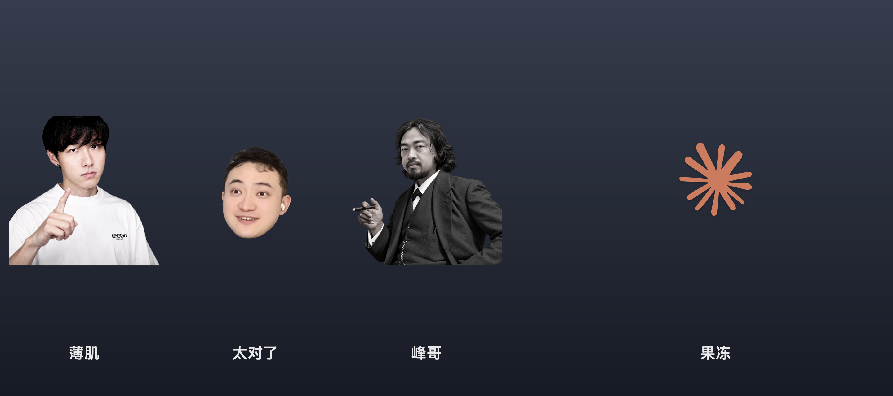

<h1 align="center">桌宠合集 · PetHub</h1>

<p align="center">薄肌 · 太对了 · 峰哥 · 果冻，四只桌宠住在一个 App 里。点一下就说，凑在一起会接话。2.0 起，薄肌还能换成你自己的角色。</p>

<p align="center">macOS 14+（Apple Silicon）/ Windows 10+ ｜ 一个 App · 一个安装包 ｜ 不联网 · 不占 Dock</p>

> **⚠️ 这是整合项目，不是原创角色项目。**
> 薄肌 / 太对了 / 峰哥 / 果冻的角色、原声、头像和原始玩法来自下面四个独立开源仓库，
> 版权归各原作者；本项目只做了四合一、架构整理、自定义内容包和跨平台封装。
> 完整署名、许可证边界和素材权利见 [CREDITS.md](CREDITS.md)。
>
> [ShaolanPet](https://github.com/Ganzhe2028/ShaolanPet) ·
> [SunPet](https://github.com/Ganzhe2028/SunPet) ·
> [FengGe-Desktop-Pet](https://github.com/Ganzhe2028/FengGe-Desktop-Pet) ·
> [JellyPet](https://github.com/aurelius358/JellyPet)

<table align="center" width="100%">
<tr>
<td align="center" width="25%"></td>
<td align="center" width="25%"></td>
<td align="center" width="25%"></td>
<td align="center" width="25%"></td>
</tr>
<tr>
<td align="center"><b>薄肌</b></td>
<td align="center"><b>太对了</b></td>
<td align="center"><b>峰哥</b></td>
<td align="center"><b>果冻</b></td>
</tr>
</table>

- **薄肌**：点一下就开始训你。37 句原声，默认只放最能笑的 8 句，右键能全开；也可以换成你自己的角色。
- **太对了**：28 句「太对了」。摇一下笔记本也会接一句（读不到传感器的机型自动关掉这个功能）。
- **峰哥**：11 句「这是个好事儿啊」。只在薄肌起的头里接话，接完就断。
- **果冻**：没有声音，一个 Q 弹的 Claude / GPT / Gemini 标志。按住会肿、拖开会拉长、松手弹回。

<p align="center"></p>
<p align="center"></p>

## 装

1. 双击 `PetHub-2.0.0.dmg`，把「桌宠合集.app」拖进「应用程序」。
2. 第一次打开会弹「无法验证开发者」：右键 App → 打开。只是没买苹果签名，不是有毒。
3. 四只会一起出现在屏幕右下角，排成一行；菜单栏右侧多一个「桌宠」。

需要 **Apple Silicon Mac + macOS 14 或更新版本**。装之前那四个独立 App 不用卸载，但合集和它们不会互相接话；
合集自己是完整的四个都齐了。

## 怎么玩

| 操作 | 结果 |
| --- | --- |
| 单击薄肌 / 太对了 / 峰哥 | 随机说一句，带字幕和说话动画；一轮播完再重来，不会连着重复 |
| 点一下薄肌起头 | 四步捧哏：薄肌 → 太对了 → 峰哥 → 太对了，第四句之后收住 |
| 按住果冻 / 拖动 | 以按压点为中心弹一下、肿一块，拖开朝光标拉长，松手 Q 弹归位；只是原地形变，窗口不会跟着走，想回默认位置用右键「回到原位」 |
| 拖动薄肌 / 太对了 / 峰哥 | 换个位置待着，退出后还记得 |
| 右键语音三只（薄肌 / 太对了 / 峰哥） | 挑一句、播放方式、轮播内容、音量、大小滑块、停止播放、移回屏幕右下角、隐藏 |
| 右键果冻 | 回到原位、大小、图标（Claude / GPT / Gemini）、隐藏果冻 |
| 点菜单栏右侧「桌宠」 | 总菜单：显示 / 隐藏、四只各自的子菜单、捧哏联动、大小联动、大小滑块、全部归位、紧凑排列、关于、退出 |
| 菜单栏「大小」滑块 | 50%–180% 无级调节，默认 100%；拉一下，四只一起变大 / 变小 |
| 菜单栏「大小联动」/ 各只菜单里的滑块 | 默认开着：拖任意一只的大小滑块，另外三只一起变；关掉就各改各的 |
| 菜单栏「紧凑排列」 | 一键把四只按约 6pt 间距收拢到屏幕右下角，排得更紧一些 |
| 菜单栏「捧哏排列（合影）」 | 一键摆成合影站位：薄肌左、太对了中间抬高、峰哥右、果冻缩在峰哥右肩后；摆好自动绑定相对位置 |
| 菜单栏「绑定相对位置」 | 打开后拖任意一只语音桌宠，四只保持队形一起移动；果冻自身仍是原地 Q 弹，只跟着走 |
| 菜单栏「桌宠」→「自定义桌宠」 | 把薄肌换成自己的角色：名字 + 头像 + 多条语音 + 中文；也能导入别人做好的 `petpack`，随时恢复原版 |

不想要哪只就隐藏哪只；「全部归位」把它们放回屏幕右下角那一排。菜单栏只有一个「桌宠」，
不会再占用四格位置，也不会出现在 Dock 里。

## 做你自己的桌宠（2.0）

2.0 起，薄肌可以换成你自己的角色——比如「我的老师」。不用写代码，也不用重新编译：

1. 菜单栏「桌宠」→「自定义桌宠」→「换成我的角色…（替换薄肌）」。
2. 填名字、选一张头像、添加多条语音，再给每条语音写一句中文。
3. 点「保存并应用」，桌面上的薄肌立刻换成你的角色。

太对了和峰哥照样接话：你点自己的角色起头 → 太对了 → 峰哥 → 太对了，四步链不变。
右键菜单里的「挑一句」「轮播内容」「音量」「大小」都还能用；随时可以「恢复原版薄肌」。
别人做好的内容包也能直接从「自定义桌宠」→「导入 petpack.json 文件夹…」装进来。

- 详细步骤（含我的老师例子）：[docs/MAKE_YOUR_OWN_PET.md](docs/MAKE_YOUR_OWN_PET.md)
- 想手写或分发内容包：[docs/PETPACK.md](docs/PETPACK.md)
- 想复用内核、加内置角色：[docs/ARCHITECTURE.md](docs/ARCHITECTURE.md)
- 模板文件夹（不含素材）：[Examples/MyTeacher/](Examples/MyTeacher/)

自己的头像和语音只存在本机，App 不上传、不联网。

## 跟原来那四个独立 App 的关系

最开始的四个仓库是四个各自独立的 App（不是四个皮肤）。这个合集把四份代码并进了**同一个进程**：

- 四只同时出现、一个菜单栏入口、一个 dmg，点哪只都是同一份 App 里的。
- 三只语音桌宠的捧哏从原来的本机通知改成了进程内广播，`hop` / `root` 规则没变，四步链和以前一样。
- 原来那四个独立 App 还能继续用，但**不会和合集里的桌宠接话**；同时开两套会在屏幕上叠着。
- 从旧 App 升级不会自动带过来位置和音量：bundle id 变了，新 App 按自己的默认布局放。

想自己编译、想改代码、想加第五只：看 [TECHNICAL.md](TECHNICAL.md)、
[docs/ARCHITECTURE.md](docs/ARCHITECTURE.md) 和 [CONTRIBUTING.md](CONTRIBUTING.md)。
上游四个仓库、合并时的 commit 和各自贡献：看 [docs/UPSTREAM.md](docs/UPSTREAM.md)。

## 自己构建

需要 Xcode Command Line Tools（`xcode-select --install`），不需要完整 Xcode，构建过程不联网。

```bash
./build.sh              # 编译 + 自检，最后一行是 PASS
./build.sh --package    # 另外在 dist/ 下产出 PetHub-2.0.0.dmg、.zip 和 .sha256
./install.sh --build    # 编译后装进「应用程序」并启动
```

只想自己用：`./build.sh && open build/桌宠合集.app`。
卸载：`./install.sh --uninstall`（四只的位置、音量等设置和自定义角色都会保留）。

## 版权

代码 MIT，见 [LICENSE](LICENSE)。**音频和头像不在 MIT 里**，版权归原权利人，这个项目只做学习交流和玩梗，不商用；
JellyPet 原仓库没有 LICENSE 文件，这里只按它 README 的「代码可自由修改」合并，公开再分发前应先联系原作者。
细节和逐条素材来源见 [NOTICE.md](NOTICE.md)。

四个上游项目：[ShaolanPet](https://github.com/Ganzhe2028/ShaolanPet) ·
[SunPet](https://github.com/Ganzhe2028/SunPet) ·
[FengGe-Desktop-Pet](https://github.com/Ganzhe2028/FengGe-Desktop-Pet) ·
[JellyPet](https://github.com/aurelius358/JellyPet)。